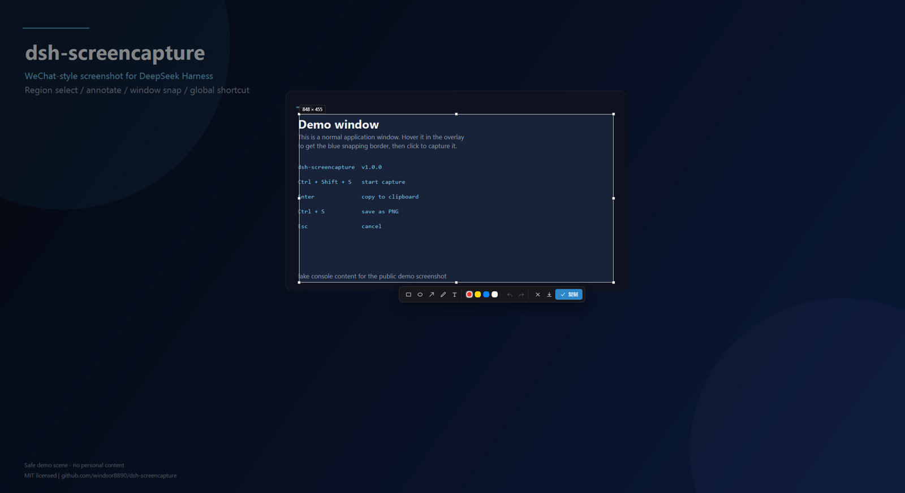
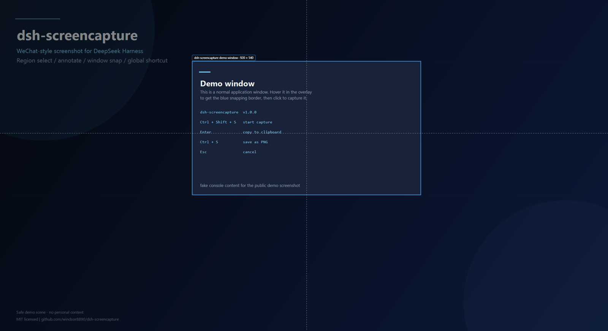

# dsh-screencapture

<p align="center"></p>

<p align="center">
  <b>在 DeepSeek Harness 里复刻「电脑版微信」的截图体验</b><br>
  WeChat-style screenshot &amp; annotation plugin for the DSH Web UI.
</p>

<p align="center">
  <a href="LICENSE"></a>
  <a href="https://github.com/windsor8890/dsh-screencapture/actions/workflows/ci.yml"></a>
  
  
  
</p>

<p align="center"><b>简体中文</b> | <a href="README.en.md">English</a></p>

---

按一下快捷键 → 冻结当前桌面 → 在 DSH 窗口里拖拽框选 → 标注 → 复制到剪贴板（或保存 PNG）。
整个交互都渲染在 DSH 窗口内部，截图完成后直接在输入框 `Ctrl + V` 粘贴发送。

> 本项目是社区插件，与腾讯 / 微信官方无关；「微信截图」仅指交互风格。

## 界面预览

以下截图使用中性演示窗口生成，不包含任何真实用户桌面内容：

| 框选与标注 | 窗口吸附 |
|---|---|
|  |  |

## 功能特性

- **快捷键唤起**：默认 `Ctrl + Shift + S`，可在「设置 → 截图」中重新录制。
  组合键需包含 `Ctrl` / `Alt` / `Meta`，且为 Host 可注册的按键。
- **全局快捷键**：默认开启，注册为 Windows 系统级热键。焦点在其它应用时按下快捷键也会
  截图，并自动把 DSH 窗口带到前台显示框选浮层；若组合键被其它软件占用，会显示注册失败状态。
- **输入框按钮**：输入框工具条左侧新增截图按钮，不方便按键盘时同样可用。
- **窗口自适应**：截图时临时最大化 DSH 窗口（记住原位置与大小），复制完成或取消后恢复；
  小窗口下也能像微信一样舒服地框选整个屏幕。
- **框选与调整**：拖拽框选、8 个控制柄缩放、显示像素尺寸角标、拖动选区内部平移选区。
- **窗口吸附**：未框选时鼠标悬停任意窗口会亮起蓝色边框并显示窗口标题 / 尺寸，单击即可
  选中整个窗口；点击空白桌面选中全屏；拖拽仍是自由框选。
- **标注工具**：矩形、椭圆、箭头、画笔、文字，红 / 黄 / 蓝 / 白四色，撤销 / 重做。
- **复制 / 保存**：`Enter`、双击或 ✓ 把「裁剪 + 标注」后的图片写入剪贴板；
  `Ctrl + S` 或下载按钮保存 PNG（默认 `图片\DSH Screenshots`，可自定义目录）。
- **可选自动保存**：开启后每次复制都会同时落盘，并在提示条上提供「打开文件夹」。
- **原生能力**：Host 半使用常驻 PowerShell 助手完成 Windows 原生截屏（物理像素、支持多显示器
  虚拟桌面）与 STA 剪贴板写入，渲染进程不需要屏幕捕获权限。

## 平台支持

| 平台 | 状态 |
|---|---|
| Windows 10 / 11（DSH Desktop，Electron） | ✅ 完整支持（本机测试于 DSH Desktop 0.2.1-rc.2） |
| Windows + 其它 DSH 运行方式 | ✅ Host 半可用（PowerShell 5.1 为系统自带） |
| macOS / Linux | ⚠️ 仅能加载插件外壳；截图 / 剪贴板 / 全局热键路由返回 `unsupported-platform` |

原生实现依赖 Windows 的 `System.Drawing`、`System.Windows.Forms`、`RegisterHotKey` 与 DWM
窗口边界 API；其它平台需要独立的原生适配层，欢迎 PR。

## 安装

前置条件：**Windows 10/11** 上的 DeepSeek Harness 桌面版（或可运行 Host 插件与 Web UI 的环境）。

### 方式一：从 GitHub 安装（推荐）

在 DSH 的「设置 → 插件 → 安装 bundle」中填入本仓库的 pnpm 安装 spec：

```
github:windsor8890/dsh-screencapture
```

安装完成后启用名为「截图 / Screenshot」的插件即可（默认快捷键 `Ctrl + Shift + S`）。

### 方式二：本地源码

```powershell
git clone https://github.com/windsor8890/dsh-screencapture.git
```

然后在 DSH 插件管理中选择该目录作为本地 bundle 安装。修改源码后：

```powershell
# 浏览器半：重建 lib/client.js，已打开的 DSH 页面会在约 0.5s 内热替换插件
node build.mjs
```

Host 半（`host/`）修改后，在 设置 → 插件 中关闭再启用该插件，或重启 DSH 即生效。

> 安装方式遵循 DSH 的 bundle 安装机制；不同 DSH 版本的插件管理入口文案可能略有差异。

## 使用方法

| 操作 | 说明 |
|---|---|
| `Ctrl + Shift + S` | 开始截图（可在设置里修改；全局快捷键开启时窗口未聚焦也有效） |
| 拖拽 | 选择截图区域 |
| 鼠标悬停窗口 + 单击 | 吸附选中整个窗口（高亮边框显示窗口标题 / 尺寸） |
| 拖动已选区域内部（未激活标注工具时） | 移动整个选区 |
| 单击空白桌面 | 选中整个屏幕 |
| 选中区域后拖拽内部 | 使用当前工具绘制标注；拖动 8 个控制柄可缩放选框 |
| `Enter` / 双击 / ✓ 按钮 | 复制选区（含标注）到剪贴板并关闭浮层 |
| `Ctrl + S` / 下载按钮 | 保存 PNG（不关闭浮层，可继续编辑） |
| `Ctrl + Z` / `Ctrl + Shift + Z` | 撤销 / 重做标注 |
| `Esc` / ✕ 按钮 | 取消，不产生任何输出 |
| 设置 → 截图 | 修改快捷键、全局快捷键、自动保存、保存目录、测试截图 |

## 设置项

- **截图快捷键**：点击「修改」后按下新组合键；需包含 `Ctrl` / `Alt` / `Meta`，
  `Esc` 取消录制，「恢复默认」回到 `Ctrl + Shift + S`。
- **全局快捷键**：控制「焦点不在 DSH 时也能截图」。开启后 Host 会向 Windows 注册系统级热键
  （与上方快捷键同一组合），注册结果实时显示；被其它软件占用时会给出失败提示。
  全局热键生效时窗口内监听自动让位，避免一次按键触发两次截图。
- **复制时同时保存图片**：默认关闭，只写剪贴板。
- **保存位置**：留空使用 `%USERPROFILE%\Pictures\DSH Screenshots`；可填任意绝对路径。
- **测试截图**：立即打开截图浮层，并显示截图引擎状态（就绪 / 待启动 / 不可用）。

## 工作原理

```
┌────────────────────── 浏览器半（lib/client.js，Client 插件） ──────────────────────┐
│ settings.section「截图」   conversation.input.left 截图按钮   shell.overlay 浮层     │
│ canvas 框选 + 标注（选区/标注均存截图原始像素坐标）→ 裁剪 + 压平 → PNG data URL     │
└───────────────────────────────────┬────────────────────────────────────────────────┘
                                    │ fetch /api/dsh-screencapture/*
┌───────────────────────────────────▼────────────────────────────────────────────────┐
│ Host 半（host/index.js，Cordis 插件，ESM，仅 Node 内置模块）                        │
│ /status /capture /clipboard /save /reveal /events(SSE) /last-capture /config        │
│ /overlay-window                                                                     │
│ capture.js ── 常驻 powershell.exe -STA 助手 ── Graphics.CopyFromScreen / 剪贴板      │
└─────────────────────────────────────────────────────────────────────────────────────┘
```

- Electron 外壳禁止渲染进程使用 `getDisplayMedia`，因此截图与剪贴板都在 Host 半完成；
  Host 进程运行在 `ELECTRON_RUN_AS_NODE=1` 的 Node 模式，没有 Electron API，于是通过
  `host/capture-helper.ps1` 常驻助手调用 .NET 的 `System.Drawing` / `System.Windows.Forms`。
- 点击路径（warm capture）约 110 ms；首次截图会启动助手，约 1s 内完成。
- 所有 HTTP 处理只在 loopback 请求上工作（socket + Host 头的 fence），不会向局域网暴露。

## 安全与隐私

- HTTP 路由只接受本机 loopback 请求，并校验 `Host` 头；不做任何远程上传。
- 截图数据只在本机内存、剪贴板与用户指定的本地目录中流转。
- Host 半只使用 Node 内置模块与系统自带 PowerShell，不引入第三方运行时依赖。
- 没有遥测、没有外部网络请求；插件只在 DSH 进程内工作。

## 已知限制

- 默认快捷键 `Ctrl + Shift + S`；若组合键被 DSH 自身或其它软件占用（例如 DSH 的「归档会话」
  占用 `Ctrl + Shift + A`、微信占用 `Alt + A`），可换一个组合键，或依赖全局快捷键。
- 截图捕获整个虚拟桌面（所有显示器），在 DSH 窗口内等比缩放显示；标注工具暂不含马赛克 / 模糊。
- 窗口吸附截取的是**冻结画面中该窗口的可见区域**，被完全遮挡的部分不会自动重建。
- 浮层渲染在 DSH 应用窗口内（受渲染层限制，不能覆盖到桌面其它窗口），因此截图时会自动
  临时最大化窗口获得接近全屏的框选体验。
- 工作站锁屏时无法截屏 / 写剪贴板，路由会返回明确错误。
- 目前仅 Windows；macOS / Linux 需要单独的原生适配。

## 开发

```powershell
# 构建浏览器半（把 src/client/*.js 拼成 lib/client.js）
node build.mjs

# 跨平台客户端测试（CI 会跑）：几何/坐标/按键映射 + 中英字典对齐
node tests/client-math-test.mjs
node tests/client-locale-test.mjs

# Host 半测试（Windows 交互式桌面）：真实截屏、剪贴板跨进程回读、保存、路由校验（17 项）
node tests/host-test.mjs

# 全局热键 / SSE / config / overlay-window 测试（20 项，会短暂注册 F12 探针）
node tests/hotkey-test.mjs
```

测试会真实使用屏幕与剪贴板，并短暂创建测试窗口，请在可交互的 Windows 桌面会话中运行。

### 目录结构

```
dsh-screencapture/
├─ package.json          # bundle manifest（dsh.bundle.patch + dsh.client）
├─ cordis.patch.yml      # 插入一行插件
├─ icon.svg              # 插件图标（原创）
├─ locale/{en,zh}.json   # 插件管理与设置里的标题 / 描述
├─ host/
│  ├─ index.js           # Cordis 插件：注册路由、生命周期、全局热键接线
│  ├─ routes.js          # 9 条路由表（含 SSE / config / overlay-window）
│  ├─ capture.js         # 常驻截屏 PowerShell 助手管理
│  ├─ hotkey.js          # 全局热键管理（RegisterHotKey、持久化、重注册）
│  ├─ global-flow.js     # 全局截屏流程 + SSE 事件中心
│  ├─ fence.js           # loopback 请求校验
│  ├─ capture-helper.ps1 # 截屏 / 剪贴板 / 激活窗口
│  └─ hotkey-helper.ps1  # 系统级热键注册（隐藏 WinForms 窗口）
├─ src/client/*.js       # 浏览器半源码（共享层 / 浮层 / 设置页 / 入口）
├─ build.mjs             # 把 src/client 拼成 lib/client.js
├─ lib/client.js         # 生成的浏览器 bundle（勿手改）
└─ tests/
   ├─ host-test.mjs      # Host 半真实环境测试（17 项）
   └─ hotkey-test.mjs    # 全局热键 / SSE / config 测试（20 项）
```

## 贡献

欢迎 Issue 与 PR：

1. Fork 并新建分支；
2. 修改后运行 `node build.mjs` 与相关测试（客户端测试跨平台，Host 两套需 Windows 交互式桌面）；
3. 提交 PR，说明动机、改动与验证结果。

详细流程见 [CONTRIBUTING.md](CONTRIBUTING.md)；安全问题请按 [SECURITY.md](SECURITY.md) 私下报告，
不要开公开 Issue。

## License

[MIT](LICENSE) © 2026 joe

<p align="center"><a href="README.en.md">English README</a></p>
